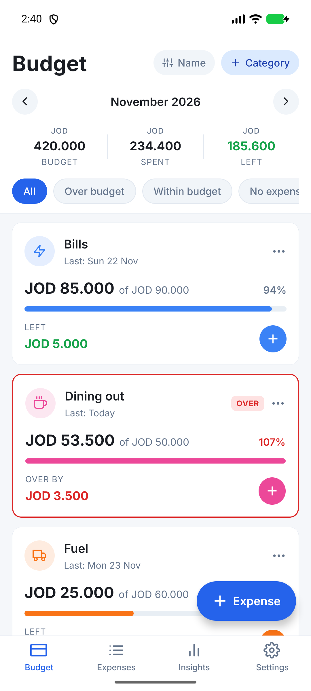
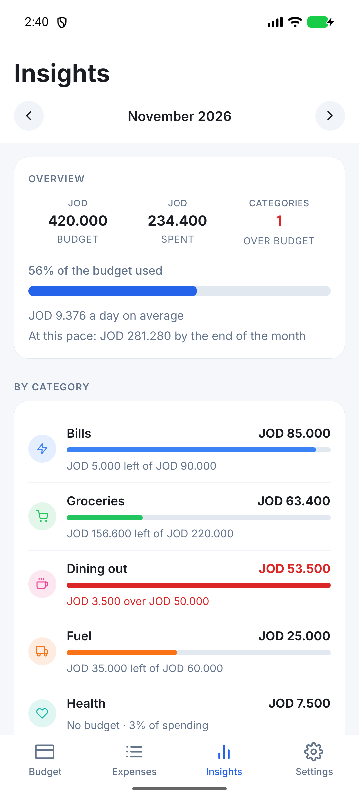

# Budget Tracker

A monthly budget app for Android that keeps every amount exact, to the fils, and keeps your data on your phone.

<p>
  
  
</p>

<sub>Screenshots from a release build on an Android 17 emulator, with sample data.</sub>

## What it does

- **Categories with monthly budgets.** See what each one has spent and has left this month, with an over-budget warning. Change a budget and earlier months keep the one they had.
- **Budget months that match your pay.** Months start on the 1st or on any day you choose, such as payday. In shorter months they start on the last day.
- **Expenses** with merchant, notes, tags and date, and a list of the merchants you use most. Edit or delete any expense.
- **Recurring expenses**, such as rent and subscriptions, every week, month or year. They are added on their dates and never twice; pause or stop them at any time.
- **Search** through every month by merchant, note, tag, category or amount. Search ignores case, accents and Arabic spelling variants.
- **Insights:** spending by category, top merchants, the daily average, a forecast for the month in progress, and the last six months.
- **Exact money.** Amounts are whole numbers of fils or cents, so totals never drift. Three-decimal currencies (JOD, KWD, BHD, OMR) are fully supported. Amount fields accept Arabic-Indic digits, `٫` and a decimal comma.
- **Backups** as JSON files you save to Files or Drive and restore from, plus a CSV export for spreadsheets. Exports from the first (Replit) version of the app can be restored too.
- Light, dark and system themes.

## Privacy

- There is no account, server, analytics or advertising.
- The Android app doesn't have the `INTERNET` permission (`app.json` blocks it), so Android itself stops it from sending anything.
- The data is kept in an SQLite database in the app's private storage.
- A backup or CSV file leaves the phone only when you save or share it. The temporary copy made for the share sheet is deleted afterwards.
- Android's own device backup (Settings › Google › Backup) includes the app's data. It is end-to-end encrypted with your screen lock. To turn it off for this app, set `"allowBackup": false` under `android` in `app.json`.

## Development

You need Node 24, and pnpm through Corepack (the version is pinned in `package.json`).

```sh
corepack enable
pnpm install
pnpm web          # web preview on localhost
pnpm start        # Metro on localhost, for a development build
```

Checks (CI runs all of them on every push and pull request):

```sh
pnpm typecheck
pnpm lint
pnpm test                          # Jest + React Native Testing Library, in Asia/Amman time
TZ=America/New_York pnpm test      # the same, west of UTC
pnpm export                        # Android and web bundles
pnpm doctor                        # expo-doctor
```

pnpm only installs package versions that have been public for at least a day (`minimumReleaseAge` in `pnpm-workspace.yaml`).

## Building the Android app

The app builds with [EAS Build](https://docs.expo.dev/build/introduction/). The `preview` profile makes an APK you can install directly:

```sh
eas build --profile preview --platform android
```

The first build links the project to your Expo account and adds its project id to `app.json`.

## How it works

- `utils/money.ts`: amounts as integer minor units, plus parsing, formatting and currency changes.
- `utils/dates.ts`: calendar days as `YYYY-MM-DD` in the phone's time zone, and budget months.
- `utils/budget.ts`: budgets, monthly totals and merchants.
- `utils/recurring.ts`: due dates for recurring expenses.
- `utils/backup.ts`: backup files. Every field is checked before anything is restored.
- `store/budgetStore.ts`: the Zustand store, saved through `storage/localStore.native.ts` (SQLite) or `storage/localStore.ts` (the browser, for the web preview).
- `app/`: the screens (Expo Router).
